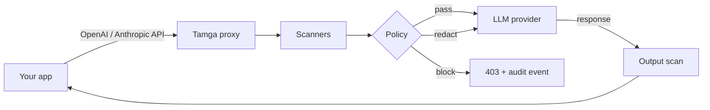

<div align="center">

<picture>
  <source media="(prefers-color-scheme: dark)" srcset="docs/logo/tamga-mark-dark.svg" />
  
</picture>

# Tamga

**A guardrail for LLM traffic that you run on your own servers.**<br/>
Tamga sits in front of the model APIs your applications, RAG pipelines and
agents call. It scans each request routed through it and blocks or redacts
PII, secrets and prompt injection before the request is forwarded to the provider.

[](https://github.com/yatuk/tamga/actions/workflows/proxy-ci.yml)
[](CHANGELOG.md)
[](LICENSE)
[](proxy/go.mod)
[](https://github.com/yatuk/tamga/stargazers)

[Website](https://tamgaproxy.com) ·
[Quick start](#quick-start) ·
[How it works](#how-it-works) ·
[Benchmarks](#benchmarks) ·
[Docs](#documentation) ·
[Status](#project-status)


</div>

## Why Tamga

An application that calls a model API forwards whatever it is handed. A
support bot passes on a ticket with the customer's national ID in it, and a
RAG pipeline retrieves a document that holds an IBAN or an API key. An agent
reads a web page that carries instructions written for the model, and that
text arrives in its next request as a tool result. The usual controls do not
help:

- **Network DLP** sees an encrypted request to an API, not what the prompt says.
- **Hosted LLM gateways** inspect your prompts on *their* servers, which is the
  data transfer you were trying to avoid.
- **Provider guardrails** cover one vendor and leave no audit trail of your own.

Tamga is a reverse proxy you run yourself. It speaks the OpenAI and Anthropic
APIs, so applications only change their base URL. It reads each request
message by message and knows whether a piece of text is the user's prompt, a
tool result, a tool description or the system prompt. Scanners look for PII,
secrets and injection wording in that text, and a YAML policy turns each
finding into a block, a redaction, a warning or a pass. A rule can be limited
to some of those roles, and a tool result that carries an injection can be
stripped so the agent's session continues. Responses are scanned too when the
policy's `output_rules` are on. Every decision is recorded in your own
Postgres. Built for KVKK, GDPR and
BDDK workloads, with first-class Turkish PII (TC Kimlik, Turkish IBAN and phone formats).

## What Tamga does not cover

Tamga sees only the requests that are sent to it. It does not see:

- **Chat websites.** Text someone types or pastes into chatgpt.com, claude.ai
  or gemini.google.com in a browser goes from the browser to that site and
  never reaches the proxy. A browser extension for this is planned. It is not
  available.
- **Traffic between an agent and its MCP servers.** The agent talks to them
  directly. What a tool returned reaches Tamga only when the agent puts it in
  its next model request, as a tool result.
- **Anything else that does not pass through the proxy.** An application that
  still calls the provider's own URL is not scanned. Tamga does not discover
  or stop such calls.
- **Images, audio and PDFs.** They are forwarded without being read. An
  attached text file is decoded and scanned.

More limits are listed under [Project status](#project-status).

## Quick start

```bash
git clone https://github.com/yatuk/tamga.git
cd tamga
cp .env.example .env    # set TAMGA_MOCK_UPSTREAM=true to try it without provider keys

docker compose --env-file .env -f deploy/docker-compose.yml up -d
```

Proxy on `http://localhost:8443`, dashboard on `http://localhost:3000`. The dashboard
holds no key: on first use it asks for the admin key (`TAMGA_ADMIN_KEY` from
`.env`) under Settings and keeps it in that browser.

> `--env-file .env` is required. Compose only auto-loads a `.env` next to the
> compose file, so without it the database password is empty and Postgres will
> not start.

Send a prompt carrying a Turkish national ID. It is blocked before it reaches
any provider:

```bash
curl -s -o /dev/null -w "%{http_code}\n" \
  -X POST http://localhost:8443/v1/chat/completions \
  -H "Content-Type: application/json" \
  -d '{"model":"gpt-4o-mini","messages":[{"role":"user","content":"Müşteri TC 10000000146"}]}'
# 403
```

Point an existing SDK at the proxy:

```python
import os
from openai import OpenAI

client = OpenAI(
    base_url="http://localhost:8443/v1",   # was https://api.openai.com/v1
    api_key=os.environ["OPENAI_API_KEY"],
)
```

Provider routes: `/v1` (OpenAI), `/anthropic`, `/gemini`, `/azure`, `/bedrock`,
`/mistral`, `/local`. The default policy allows the first four. Only the first
three are tested by forwarding a request to a stand-in provider; see
[Project status](#project-status).

## How it works



1. **Scan.** Deterministic scanners run in-process on every request: an
   Aho-Corasick automaton plus validators (Luhn, TCKN and IBAN checksums) and
   Unicode normalization against homoglyph and zero-width evasion.
   Optionally, a local model then reads what the rules did not block and
   flags injection by meaning rather than wording
   ([inline classifier](docs/operations.md#inline-classifier)).
2. **Decide.** A YAML policy maps findings to `BLOCK`, `REDACT`, `WARN` or
   `PASS`. It hot-reloads, is parsed strictly, and warns at startup if nothing
   acts on PII, secrets or injection.
3. **Forward.** Clean or redacted requests go to the provider. Responses are
   scanned on the way back when the policy's `output_rules` are on; they are
   off in the shipped policy.
4. **Record.** Every decision becomes an event in the Postgres request log
   and the dashboard. A blocked, stripped or warned request is also posted to
   the [alert destinations](docs/operations.md#alerts) you have connected,
   and to the `notify:` URL of the rule that matched.

Diagrams for the request lifecycle, scanner pipeline, policy flow and database
schema are in [docs/architecture](docs/architecture/README.md).

## What it catches

| | Detects | Default action |
|---|---|---|
| **PII** | TC Kimlik, credit cards (Luhn + BIN), IBAN, email, phone, IP | Block IDs and cards, redact the rest |
| **Secrets** | AWS, Azure storage, GitHub, GitLab, OpenAI, Anthropic, Stripe, Slack, npm and PyPI keys and tokens, JWTs, private keys, connection strings, credentials in URLs ([all formats](proxy/internal/scanner/patterns/README.md#secret-formats)) | Block |
| **Prompt injection** | Instruction override, role manipulation, jailbreak patterns, encoded payloads, text hidden in invisible characters; EN/TR/DE | Block |
| **Custom entities** | Your own regex patterns (customer numbers, file IDs), editable from the dashboard | Per entity |
| **System-prompt leaks** | Canary token injected into the system prompt and looked for in the response | Block (opt-in) |
| **Decision governance** | Prompts that contradict a locked decision in a [jugeni](https://github.com/jugeni/jugeni-contracts) audit log | Per assertion (opt-in) |

Also in the box: reversible PII tokenization (vault), per-key rate limits, a
daily budget per organisation, provider allowlists, a response cache, and a SOC dashboard with
an incident queue. See [docs/operations.md](docs/operations.md), and
[docs/agents.md](docs/agents.md) for running Claude Code and other agents through it.

<p align="center">
  
</p>

## Benchmarks

Measured on 2026-10-03. Everything here is reproducible from this repository.

**Accuracy**, as precision / recall, on two sets of prompts written for this
repository. The inline classifier is optional: a local model asked about what
the rules did not block, here
[`prompt-injection-guard-small`](https://huggingface.co/Horizon-Labs/prompt-injection-guard-small)
at threshold 0.98.

| Set | Prompts | Deterministic scanners alone | With the inline classifier |
|---|---|---|---|
| Tuning corpus `prompts.csv` (gates CI) | 309, of which 117 benign | 1.000 / 0.896 | 1.000 / 0.927 |
| Held-out set `holdout.csv` | 163, of which 85 benign | 1.000 / 1.000 | 1.000 / 1.000 |

On 2026-10-11 the tuning corpus grew by 22 prompts written together with new
detectors (331, of which 121 benign). The deterministic scanners score
1.000 / 0.905 on it: the 18 added attacks are caught and the 20 misses are
the same 20. A second change that day (translation requests no longer
blocked, a URL's user and password no longer read as an e-mail address,
instructions spelled one letter at a time read) added 30 more (361, of which
138 benign; the held-out set got 6 benign translation requests, 169 of which
91 benign): 1.000 / 0.910 and 1.000 / 1.000, with the same 20 misses. The
classifier has not been run on the larger corpus.

Source: [docs/benchmarks/README.md](docs/benchmarks/README.md#with-the-inline-classifier),
from the reports
[redteam_latest.json](docs/benchmarks/redteam_latest.json),
[redteam_holdout.json](docs/benchmarks/redteam_holdout.json),
[redteam_classifier_latest.json](docs/benchmarks/redteam_classifier_latest.json) and
[redteam_classifier_holdout.json](docs/benchmarks/redteam_classifier_holdout.json).

Read that honestly. The rules were written against the misses in the tuning
corpus, so its recall says how well they fit it, not how they do on new
traffic; on 2026-10-01, before that work, the same corpus scored 0.969 / 0.495. The
held-out set was written separately but by the same author, in the same attack
families, so it overstates too. Expect less on your own traffic and measure
there. What the rules still miss in the corpus is semantic: fictional and
hypothetical framings, data-exfiltration requests, health data, street
addresses.

**What the classifier added.** On the tuning corpus it caught 6 attacks the
rules missed and flagged no benign sample. On the held-out set it added
nothing: the rules already caught every attack. The threshold was chosen on the tuning corpus as the lowest that flagged no
benign sample, then run unchanged on the held-out set. The gain is small
because both sets were built around what rules can catch; they are the wrong
instrument for a model whose purpose is phrasing nobody anticipated, and no
independent set has been run yet. A classifier call took p50 14–24 ms and
p95 23–58 ms across runs on the machine below; text seen in the last ten
minutes is answered from memory. At threshold 0.9 the classifier catches two
more attacks in the tuning corpus and flags 1 of its 117 benign samples, and
2 of the 85 in the held-out set. It did not catch the three injection vectors
that bypass the adversarial suite.

**Latency.** Scan stage: p50 0.2 ms, p95 0.7–0.8 ms. End to end through the
Docker Compose stack with a mocked upstream:

| Load | P50 | P95 | P99 | Errors |
|---|---|---|---|---|
| 100 RPS | 2.6 ms | 4.0 ms | 5.4 ms | 0% |
| 500 RPS | 1.6 ms | 3.3 ms | 6.6 ms | 0% |
| 1000 RPS | 1.6 ms | 5.0 ms | 9.9 ms | 0% |

16-core laptop CPU, Docker limited to 12 GB. The medians repeat from run to
run; the tails do not: runs on this day gave a P95 at 1000 RPS anywhere from
3.0 to 5.0 ms. These also depend on hardware: an earlier run on a 4-core
machine held the same P95 to 500 RPS and reached 130 ms at 1000. The prompts
are chat-sized; for large requests see [docs/agents.md](docs/agents.md#speed).

**Adversarial suite.** 84 attack vectors written to evade the scanners: 78
detected, 6 bypass. Nineteen of them attack the structure of the request
rather than its wording: text in JSON escapes, in tool results, tool call
arguments, tool descriptions and attachments, and bodies that parsers read
differently. The bypasses are published in
[tests/stress/baseline.json](tests/stress/baseline.json) and include leetspeak
and character-by-character smuggling. That is the run of 2026-10-03: since
2026-10-11 the scanners read the two character-by-character vectors
(measured in-process,
[docs/benchmarks](docs/benchmarks/README.md#letter-by-letter-spelling)), and
the suite has not been run again, so the baseline still lists them. The vectors are known to the authors, so this is a regression
suite, not an independent evaluation. With the classifier on, the result was
the same 78 and 6, and the load figures were within the run-to-run spread of
the table above (the load test repeats its prompts, so it exercises the
classifier's cache, not the model). No result file for that run is in the
repository; the baseline describes the run without the classifier.

```bash
cd proxy && go run ./cmd/redteam -in ./testdata/redteam/prompts.csv   # accuracy
./tests/stress/run_stress_suite.sh                                    # adversarial + load
```

Method and per-category results: [docs/benchmarks](docs/benchmarks/README.md) ·
[tests/stress](tests/stress/README.md)

## How it compares

| | Tamga | Hosted gateways | OSS gateways | Network DLP |
|---|---|---|---|---|
| Runs entirely on your infrastructure | Yes | No | Yes | Usually |
| Turkish PII (TCKN, IBAN, phone) | Native | Not checked | Not checked | Not checked |
| KVKK / BDDK control mapping | Documented | Not checked | Not checked | Not checked |
| Inline redaction | Yes | Varies | Varies | Only on traffic it can decrypt |
| Reversible tokenization | Yes | Varies | Varies | Varies |
| Hash-chained audit log | Admin actions | Not checked | Not checked | Not checked |
| Published bypasses | Yes | Not checked | Not checked | Not checked |
| Open source | AGPL-3.0 | Mostly no | Yes, licence varies | Mostly no |

The three columns on the right describe a class of product, not a product. No
product or version was tested for this table; "Not checked" means that.

Tamga is a security layer, not a general LLM gateway. If you mainly need
routing, load balancing and semantic caching across many providers, a
dedicated gateway does that better; Tamga can sit in front of or behind one.
More in [docs/comparison.md](docs/comparison.md).

## Configuration

<details>
<summary><b>Policy</b> — one YAML file, hot-reloaded</summary>

```yaml
version: "1.0"
name: "default-policy"

rules:
  pii_detection:            # contact-style PII is redacted
    action: REDACT
    sensitivity: medium
    types: [iban, email, phone_tr, phone, vkn, ip_public]

  pii:                      # critical identifiers are blocked
    action: BLOCK
    sensitivity: medium
    types: [tc_kimlik, credit_card, ssn]

  secret_detection:
    action: BLOCK
    sensitivity: low

  injection:
    action: BLOCK
    sensitivity: medium

vault:                      # reversible tokenization instead of masking
  enabled: false

canary:                     # system-prompt leak detection
  enabled: false
  block_on_leak: true

providers:
  allowed: [openai, anthropic, azure, gemini]

rate_limit:
  max_requests_per_minute: 60
  max_tokens_per_day: 500000
  action_on_exceed: BLOCK
```

The shipped policy is [proxy/tamga-policy.yaml](proxy/tamga-policy.yaml). An
unknown or misplaced key is a load error, not a silent no-op.

</details>

<details>
<summary><b>Environment variables</b></summary>

| Variable | Default | Purpose |
|---|---|---|
| `TAMGA_PROXY_PORT` | `8443` | Listen port (proxy and management API) |
| `TAMGA_POLICY_PATH` | `./tamga-policy.yaml` | Policy file. The default is relative to the proxy's working directory; the file in this repository is `proxy/tamga-policy.yaml` |
| `TAMGA_ADMIN_KEY` | — | Key for the management API |
| `TAMGA_DB_URL` | — | PostgreSQL DSN; empty disables persistence |
| `REDIS_URL` | — | Rate limiting, cache, vault store |
| `TAMGA_MOCK_UPSTREAM` | `false` | Answer with a canned response instead of calling a provider |
| `TAMGA_VAULT_KEY` | — | Base64 32-byte AES key for vault entries at rest |
| `TAMGA_FINDING_HASH_KEY` | — | Base64 key (32 bytes or more) for the hashes of finding matches in the request log (`data.hash_findings`); empty derives one from `TAMGA_VAULT_KEY` |
| `TAMGA_TRUST_ROLE_HEADER` | `false` | Honour `X-Tamga-Role` for policy exceptions; only behind an authenticating gateway |
| `TAMGA_REQUIRE_KEY` | `false` | Refuse proxy requests that carry no valid `X-Tamga-Key` |
| `TAMGA_CLASSIFIER_ADDR` | — | gRPC address of the optional classifier service; the policy's `scan.classifier` turns it on |
| `TAMGA_UPSTREAM_ALLOW` | — | Hosts a policy's provider pool may point at beyond the vendors' own |
| `TAMGA_ALERT_ALLOW_PRIVATE` | — | Internal receivers alerts may be sent to (CIDR ranges, exact host names). Empty: internal addresses are refused |
| `TAMGA_TRUSTED_PROXIES` | — | IPs / CIDR ranges of the load balancers allowed to set `X-Forwarded-For`. Empty: the header is ignored |
| `TAMGA_SCANNER_SERVICE_ADDR` | — | Delegate stateless scanners to a scanner-service over gRPC |
| `TAMGA_RETENTION_REQUEST_LOGS_DAYS` | `30` | How long request metadata is kept |

Full list: [docs/operations.md](docs/operations.md) · [proxy/README.md](proxy/README.md)

</details>

<details>
<summary><b>Kubernetes</b></summary>

```bash
helm install tamga ./deploy/helm/tamga-proxy -n security --create-namespace
```

No public container image is published yet: build one from `proxy/Dockerfile`,
push it to your registry, and set `image.repository` in `values.yaml`.

The chart has not been tested: nothing in this repository lints, renders or
installs it, and its version fields are behind the release. Read the
templates before you rely on it.

</details>

**What is stored.** Request metadata and masked findings, for 30 days by
default. Prompt and response bodies are not written to the database.

## Documentation

| | |
|---|---|
| [Architecture](docs/architecture/README.md) | Deployment topology, request lifecycle, scanner pipeline, schema |
| [Operations](docs/operations.md) | Configuration, vault, canary tokens, budgets, management API |
| [Compliance](docs/compliance/) | KVKK, BDDK, GDPR and OWASP LLM Top 10 mappings |
| [Benchmarks](docs/benchmarks/README.md) | Method, corpus and per-category results |
| [Development](docs/development.md) | Repository layout, local commands, tech stack |
| [Writing a scanner](docs/scanner-development.md) | Stateful scanners with request context |
| [Migrating from LLM Guard](docs/migrating-from-llm-guard.md) | Scanner by scanner: what Tamga replaces, in part or not at all |
| [LiteLLM guardrail](docs/litellm.md) | Adding Tamga to a LiteLLM proxy as a guardrail, without its proxy in the path |
| [jugeni integration](docs/integrations/jugeni.md) | Operator-state decision governance |
| [Use cases](docs/use-cases.md) · [FAQ](docs/faq.md) | Where it fits, common questions |

## Project status

Pre-1.0 and maintained by one person. Use it, test it against your own traffic,
and expect rough edges.

**Works today**, each with a test that runs the whole path against a stand-in
for the other side: inline PII, secret and injection scanning · YAML policy
with hot reload · the OpenAI, Anthropic and Gemini routes · role-aware
scanning of tool results, and `STRIP` · the optional inline classifier ·
per-key rate limits · a daily token and cost cap per organisation · response
cache · the Postgres request
log · `POST /api/v1/scan` · the endpoint a LiteLLM proxy calls as a
guardrail ([LiteLLM](docs/litellm.md)) · Docker Compose.

None of it has been run against a real provider or a real third-party service
as part of the tests: the other side is always a stand-in. That includes
LiteLLM: the test that runs a real LiteLLM container against the endpoint is
written and has not been run yet.

**In the repository, not tested end to end.** The code is there; nothing
exercises the whole path, so treat these as experimental:

- The `/azure`, `/bedrock`, `/mistral` and `/local` routes. No test forwards a
  request through them; the Bedrock signature is checked only for its headers.
- Alert destinations (Slack, Teams, Splunk, Sentinel, QRadar, Datadog, Jira,
  PagerDuty, Opsgenie, ServiceNow). Decisions are delivered to them, each in
  its own format, and that is tested against local stand-ins. None has been
  tried against the real service, and several need their authentication
  header added by hand ([alerts](docs/operations.md#alerts)).
- Streamed-response scanning outside OpenAI chat completions. The Anthropic,
  Gemini and OpenAI Responses stream formats are tested at parsing level only.
- The Helm chart and the Terraform module (never linted, rendered or applied).
- The Python and TypeScript SDKs (unit tests with a mocked transport, not
  run in CI).
- The analyzer (its tests mock Presidio, LLM Guard and the LLM judge).
- Redis, NATS and OpenTelemetry export: tested with in-memory or mocked
  substitutes, not against the real servers.
- mTLS as the proxy sets it up, the remote scanner service, and SCIM (no
  tests at all).
- The dashboard against a real proxy: the browser tests in CI answer the API
  themselves; the suite that drives a real proxy is run by hand.

The audit log's hash chain covers administrative actions. Request decisions
are stored in the request log, which is not chained.

**On `main`, not yet released (v0.9.0):** vault · canary tokens · trend graphs ·
custom entity UI · the security fixes listed in the [changelog](CHANGELOG.md).

**Known limits:**

- The rules match wording. An attack phrased in a way no rule anticipates
  needs the optional [classifier](docs/operations.md#inline-classifier), and
  that has not been measured on a set its author did not write (see
  [Benchmarks](#benchmarks)).
- Images, audio and PDFs are not read.
- Callers are authenticated only when you issue keys; requests without one
  are refused only with `TAMGA_REQUIRE_KEY=true`. See [SECURITY.md](SECURITY.md).
- Streamed responses are scanned only with `output_rules.streaming` on, and
  then only the model's text: tool-call arguments and thinking pass unread.
- The first scan of a very large request is slow, about 250 KB of new text a
  second per core ([agents](docs/agents.md#speed)).
- Traffic from a browser to a chat site, and between an agent and its MCP
  servers, does not pass through a proxy at all.
- There is no multi-region replication, no SSO sign-in beyond GitHub OAuth
  (SSO settings are stored and used by no sign-in; the SCIM routes have no
  store behind them) and no custom roles.

**Planned next,** in this order, with no dates and no promise: a locked
evaluation set for the scanners and the classifier · response scanners for
malicious links and for JSON that does not match a schema · a browser
extension for chat sites. MCP inspection is not in the plan.

## Related projects

- **[jugeni](https://github.com/jugeni/jugeni-contracts)** by Mike Czerwiński —
  an operator-state framework. Tamga reads its audit log to enforce locked
  decisions before a call is made.
- **[MCPRadar](https://github.com/yatuk/mcpradar)** — a pre-deployment security
  scanner for MCP servers. Static analysis before you deploy; Tamga at runtime.

## Contributing

Issues and pull requests are welcome. Start with
[CONTRIBUTING.md](CONTRIBUTING.md); `cd proxy && go test ./...` runs the suite,
and the Postgres integration tests need Docker.

Found a way past a scanner? That is exactly what the
[adversarial suite](tests/stress/README.md) is for — open an issue or send the
vector as a pull request. For anything exploitable, follow
[SECURITY.md](SECURITY.md) instead.

## License

Tamga is free software under the
[GNU Affero General Public License, version 3](LICENSE) (AGPL-3.0). That is
the only licence and this repository is the only edition: nothing is held
back for a paid one.

You may run, study, change and share it under that licence. If you change it
and let people use your version over a network, section 13 requires you to
offer those users the source code of your version, at no charge. The
[licence text](LICENSE) is what applies; this paragraph only points at it.

<div align="center">
<br/>
<sub>© 2026 Fatih Serdar Çakmak · <a href="https://tamgaproxy.com">tamgaproxy.com</a></sub>
</div>
