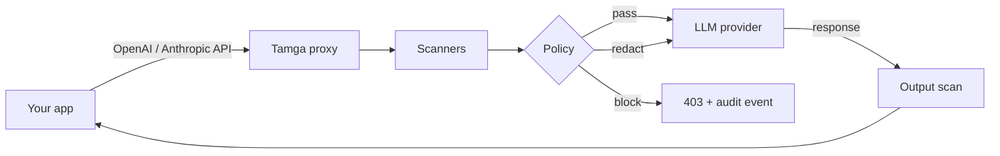

<div align="center">

<picture>
  <source media="(prefers-color-scheme: dark)" srcset="docs/logo/tamga-mark-dark.svg" />
  
</picture>

# Tamga

**A self-hosted LLM security gateway that understands Turkish and English
traffic and keeps the data on your own servers.**

[](https://github.com/yatuk/tamga/actions/workflows/proxy-ci.yml)
[](CHANGELOG.md)
[](LICENSE)
[](proxy/go.mod)
[](https://github.com/yatuk/tamga/stargazers)

[Quick start](#quick-start) ·
[What it catches](#what-it-catches) ·
[Integrations](#integrations) ·
[Compared with](#compared-with-llm-guard-and-nemo-guardrails) ·
[Docs](#documentation) ·
[Website](https://tamgaproxy.com)


</div>

Tamga is a reverse proxy that speaks the OpenAI and Anthropic APIs. Your
application changes its base URL and nothing else. Tamga reads each request
message by message, finds PII, secrets and prompt injection, and a YAML
policy decides whether the request is blocked, redacted or passed on to the
provider. Decisions are recorded in your own Postgres; prompt and response
bodies are not stored.

## Quick start

You need git and Docker with Compose v2. The commands are for a POSIX shell
(Linux, macOS, WSL or Git Bash).

```bash
git clone https://github.com/yatuk/tamga.git
cd tamga
TAMGA_MOCK_UPSTREAM=true docker compose -f deploy/docker-compose.yml --profile minimal up -d
```

This builds and starts the proxy alone, on `http://localhost:8443`. The first
build takes a few minutes. `TAMGA_MOCK_UPSTREAM=true` makes Tamga answer with
a canned reply instead of calling a provider, so nothing leaves your machine
and no provider key is needed. In PowerShell, run
`$env:TAMGA_MOCK_UPSTREAM="true"` first and leave it out of the command. If
port 8443 is taken, put `TAMGA_PROXY_PORT=8543` in front of the command as
well and use that port below.

Send three requests:

```bash
# A clean prompt is forwarded (here: to the mock), 200
curl -s http://localhost:8443/v1/chat/completions -H "Content-Type: application/json" \
  -d '{"model":"gpt-4o-mini","messages":[{"role":"user","content":"Summarise our refund policy"}]}'

# A Turkish national ID (TC Kimlik) is blocked before any provider sees it, 403
curl -s http://localhost:8443/v1/chat/completions -H "Content-Type: application/json" \
  -d '{"model":"gpt-4o-mini","messages":[{"role":"user","content":"Customer TC 10000000146"}]}'

# An email address is masked and the request forwarded, 200 with X-Tamga-Redacted-Count: 1
curl -s -D - http://localhost:8443/v1/chat/completions -H "Content-Type: application/json" \
  -d '{"model":"gpt-4o-mini","messages":[{"role":"user","content":"Write to ayse@example.com"}]}'
```

The 403 body lists each finding: its type, where it was found and a masked
match. Stop it with
`docker compose -f deploy/docker-compose.yml --profile minimal down`.

The proxy alone keeps no record: no request log, no console, and keys made
through the API are lost on restart
([what it does and does not do](docs/operations.md#proxy-only)).

### With the console

The full stack adds the console, the request log in Postgres, the analyzer,
Redis, NATS and Jaeger. It needs six secrets in `.env`; the loop below fills
them with random values:

```bash
docker compose -f deploy/docker-compose.yml --profile minimal down
cp .env.example .env
for v in TAMGA_ADMIN_KEY POSTGRES_PASSWORD REDIS_PASSWORD \
         TAMGA_ANALYZER_TOKEN TAMGA_SCANNER_SERVICE_TOKEN TAMGA_CLASSIFIER_TOKEN; do
  sed -i.bak "s/^$v=\$/$v=$(openssl rand -hex 32)/" .env
done
rm .env.bak
TAMGA_MOCK_UPSTREAM=true docker compose --env-file .env -f deploy/docker-compose.yml up -d
```

Building all the images takes a few minutes more. A TLS edge then serves the
proxy on `https://localhost:8443` and the console on `https://localhost:3000`,
with a certificate from a local CA of its own. Browsers and clients warn about
it until you trust that CA's root ([TLS](docs/operations.md#tls)):

```bash
docker compose --env-file .env -f deploy/docker-compose.yml cp \
  edge:/data/caddy/pki/authorities/local/root.crt ./tamga-edge-root.crt
curl --cacert tamga-edge-root.crt https://localhost:8443/health   # Git Bash: add --ssl-no-revoke
```

Add `tamga-edge-root.crt` to your operating system's or browser's trust
store and open `https://localhost:3000`. The console holds no key: under
Settings it asks for the admin key (`grep TAMGA_ADMIN_KEY .env`) and keeps it
in that browser. Requests you send to `https://localhost:8443` now appear
under Overview, Incidents and Events.

- `--env-file .env` is required: without it Compose does not read `.env` and
  Postgres does not start.
- If Compose says a network pool overlaps (another Tamga stack on the same
  host, for example), set `TAMGA_EDGE_SUBNET`, `TAMGA_EDGE_IP_RANGE` and
  `TAMGA_EDGE_ADDR` together ([TLS](docs/operations.md#tls)).
- Without `TAMGA_MOCK_UPSTREAM=true`, clean requests go to the real provider
  with the caller's own API key.

More in [docs/operations.md](docs/operations.md#docker-compose-profiles), and
in Turkish in [docs/tr/kurulum-ve-isletim.md](docs/tr/kurulum-ve-isletim.md).

## What it catches

Each row links to the tests or the measurement behind it. The numbers come
from [docs/benchmarks](docs/benchmarks/README.md); read the caveats there.

| | What | Shipped policy | Backed by |
|---|---|---|---|
| **Turkish PII** | TC Kimlik (checksum), VKN, MERSIS number, Turkish passport, Turkish IBAN and phone numbers | TC Kimlik blocked, the rest redacted | [`pii_tr_ids_test.go`](proxy/internal/scanner/pii_tr_ids_test.go), [`pii_test.go`](proxy/internal/scanner/pii_test.go) |
| **Other PII** | Card numbers (Luhn), IBAN, email, phone, US SSN, IP addresses, IMEI | Cards and SSN blocked, the rest redacted | [`pii_test.go`](proxy/internal/scanner/pii_test.go), [`pii_card_mask_test.go`](proxy/internal/scanner/pii_card_mask_test.go) |
| **Secrets** | Cloud, code-host, payment and LLM provider keys, JWTs, private keys, connection strings, credentials in URLs ([formats](proxy/internal/scanner/patterns/README.md#secret-formats)) | Blocked | [`secrets_formats_test.go`](proxy/internal/scanner/secrets_formats_test.go) |
| **Prompt injection** | Instruction override, role play, jailbreak wording, in English, Turkish and German | Blocked | [`injection_test.go`](proxy/internal/scanner/injection_test.go), [`injection_turkish_test.go`](proxy/internal/scanner/injection_turkish_test.go), [`injection_i18n_test.go`](proxy/internal/scanner/injection_i18n_test.go) |
| **Hidden text** | Base64, hex and other encodings, zero-width and look-alike characters, leetspeak, words spelled one letter at a time | Read before scanning | [Encoded and invisible text](docs/benchmarks/README.md#encoded-and-invisible-text), [`normalize/`](proxy/internal/scanner/normalize/) |
| **Injection in tool results** | Text an agent fetched and sent back as a tool result; the scanners know the role of each piece of text | `STRIP` removes it and the session goes on | [`strip_test.go`](proxy/internal/proxy/strip_test.go), [docs/agents.md](docs/agents.md) |
| **Files** | PDF, DOCX, XLSX, PPTX and images (OCR) in a request, and encrypted files | Off until the policy has an `attachments` section | [`attachments_test.go`](proxy/internal/proxy/attachments_test.go), [Files a request carries](docs/operations.md#files-a-request-carries) |

How well the injection rules do depends on who wrote the test set:

| Set | Result |
|---|---|
| Tuning corpus, written with the rules (361 prompts, 2026-10-11) | precision 1.000, recall 0.910 |
| Held-out set, same author (169 prompts, 2026-10-11) | precision 1.000, recall 1.000 |
| Turkish sets written by others, rules alone | 27 of 203 and 2 of 59 attacks caught, no benign prompt flagged |
| Adversarial suite (84 vectors, run of 2026-10-03) | 78 caught, 6 bypass, [published](tests/stress/baseline.json) |

The rules match wording. Attacks with no override phrase (a persona, a task
slipped in after a question) mostly get past them; the optional
[inline classifier](docs/operations.md#inline-classifier), a small local
model, is for those. Sources:
[tuning and held-out](docs/benchmarks/README.md#changes-to-the-corpus-after-that-run-2026-10-11),
[sets written by others](docs/benchmarks/README.md#two-turkish-sets-written-by-someone-else-2026-10-17),
[adversarial suite](tests/stress/README.md). Expect less on your own traffic,
and measure there.

**Latency.** The scan stage takes p50 0.2 ms and p95 0.7 to 0.8 ms
([benchmarks](docs/benchmarks/README.md#aggregate)). End to end through the
Compose stack with a mocked upstream (2026-10-03, 16-core laptop CPU), P95
was 4.0 ms at 100 requests a second, 3.3 ms at 500 and 5.0 ms at 1000, with
no errors. Medians repeat between runs, tails do not, and a 4-core machine
reached 130 ms at 1000 ([load suite](tests/stress/README.md)).

## Integrations

Examples use the quick start's `http://localhost:8443`; replace it with your
own host. Your provider key is sent as before and goes to the provider.

**OpenAI SDK.** Change the base URL; the key is read from `OPENAI_API_KEY`
as before ([agents](docs/agents.md#agent-sdks-and-your-own-agents)):

```python
from openai import OpenAI
client = OpenAI(base_url="http://localhost:8443/v1")   # was https://api.openai.com/v1
client.chat.completions.create(model="gpt-4o-mini",
    messages=[{"role": "user", "content": "Customer TC 10000000146"}])   # raises PermissionDeniedError (403)
```

**Anthropic SDK.** The `/anthropic` route, also for Claude Code with
`ANTHROPIC_BASE_URL` ([agents](docs/agents.md)):

```python
import anthropic
client = anthropic.Anthropic(base_url="http://localhost:8443/anthropic")
client.messages.create(model="claude-sonnet-4-5", max_tokens=256,
    messages=[{"role": "user", "content": "Summarise our refund policy"}])
```

**LiteLLM guardrail.** Tamga checks a LiteLLM proxy's traffic without being
in its path ([docs/litellm.md](docs/litellm.md)):

```yaml
guardrails:
  - guardrail_name: tamga
    litellm_params:
      guardrail: generic_guardrail_api
      mode: [pre_call, post_call]
      api_base: http://localhost:8443/api/v1
      api_key: os.environ/TAMGA_KEY        # a Tamga key with scope "proxy"
      default_on: true
```

**Ollama, or Open WebUI in front of it.** The `/local` route speaks the
OpenAI API. Point it at Ollama, allow it in the policy, and restart the
proxy:

```bash
echo 'TAMGA_LOCAL_URL=http://host.docker.internal:11434' >> .env   # Ollama on the Docker host
# proxy/tamga-policy.yaml:  providers: allowed: [openai, anthropic, azure, gemini, local]
```

Clients, Open WebUI among them (as an OpenAI API connection), then use
`http://localhost:8443/local/v1` as their base URL. On Linux,
`host.docker.internal` needs an `extra_hosts` entry, or use the host's
address. This was tried against a stand-in for Ollama only; no test runs
the `/local` route end to end
([`TAMGA_<PROVIDER>_URL`](docs/operations.md#configuration)).

**Browser extension.** For text typed into chat sites, which never passes
through a proxy. It asks your Tamga for a verdict at paste and at send. In
Chrome: `chrome://extensions`, Developer mode, Load unpacked, choose
`extension/`, then set your Tamga URL and a `proxy` key in its options. It is
an MVP, run once on three live sites
([docs/browser-extension.md](docs/browser-extension.md)).

**MCP gateway.** Tamga in front of an agent's MCP servers: tool lists, tool
results and tool-call arguments are judged by the policy
([docs/mcp.md](docs/mcp.md)):

```yaml
# file named by TAMGA_MCP_CONFIG; the agent then uses http://localhost:8443/mcp/github
servers:
  - name: github
    url: https://mcp.example.com/mcp
    tools: [search_issues, "get_*"]
```

Other routes: `/gemini`, `/azure`, `/bedrock`, `/mistral`, `/local`. Editors
and coding assistants: [docs/ide.md](docs/ide.md). A company web proxy can
ask Tamga over [ICAP](docs/icap.md).

## Compared with LLM Guard and NeMo Guardrails

All three are open source and run on your own machines.

- **[LLM Guard](https://pypi.org/project/llm-guard/)** is a Python library
  of input and output scanners (MIT). You call it from your code around each
  model call; it can also run as an API server. Its repository was archived
  in July 2026. The [migration page](docs/migrating-from-llm-guard.md) goes
  scanner by scanner through what Tamga replaces, in part or not at all.
- **[NeMo Guardrails](https://pypi.org/project/nemoguardrails/)** is a
  Python toolkit (Apache-2.0) for programmable rails around a conversational
  application: input, dialog, retrieval, execution and output rails, with
  dialogue flows written in its own language, Colang. Some of its rails ask
  an LLM to check the text. It can steer what a bot says and does, which
  Tamga does not try to do.
- **Tamga** is a proxy in front of the provider API, so applications change
  only their base URL and need no new library. Its scanners are Go code in
  the request path (a scan takes under a millisecond at the median); a model
  is optional. Around them are a policy file, a request log, a console and
  alerts. Its rules are written for Turkish identifiers and Turkish
  injection wording as well as English.

Measured side by side: [docs/benchmarks/comparison.md](docs/benchmarks/comparison.md).
A wider comparison by product class is in [docs/comparison.md](docs/comparison.md).

## How it works



1. **Scan.** Deterministic scanners run in the proxy on every request, with
   checksum validators (Luhn, TC Kimlik, IBAN) and Unicode normalization.
   An optional local classifier reads what the rules did not block.
2. **Decide.** A YAML policy maps findings to `BLOCK`, `REDACT`, `STRIP`,
   `WARN` or `PASS`. It hot-reloads, and an unknown key is a load error.
3. **Forward.** Clean or redacted requests go to the provider. Responses are
   scanned too when the policy's `output_rules` are on (off by default).
4. **Record.** Each decision is an event in the Postgres request log and the
   console, and can be sent to [alert destinations](docs/operations.md#alerts).

Diagrams: [docs/architecture](docs/architecture/README.md).

### What Tamga does not see

Only requests sent to it are scanned. An
application that still calls the provider's own URL, text typed into a chat
website (see the browser extension), and traffic between an agent and its
MCP servers (see the MCP gateway) pass it by. Audio, archives and legacy
office files are never read.

## Configuration

The shipped policy is [proxy/tamga-policy.yaml](proxy/tamga-policy.yaml);
edit it and the proxy reloads it. A small one:

```yaml
version: "1.0"
name: "default-policy"

rules:
  pii_detection:            # contact details are redacted
    action: REDACT
    sensitivity: medium
    types: [iban, email, phone_tr, phone, vkn, ip_public]

  pii:                      # national IDs and cards are blocked
    action: BLOCK
    sensitivity: medium
    types: [tc_kimlik, credit_card, ssn]

  secret_detection:
    action: BLOCK
    sensitivity: low

  injection:
    action: BLOCK
    sensitivity: medium

providers:
  allowed: [openai, anthropic, azure, gemini]
```

Starting points for KVKK, banks, public bodies and software teams are in
[docs/policy-templates.md](docs/policy-templates.md).
Every environment variable is described in
[docs/operations.md](docs/operations.md#configuration) and in
[`.env.example`](.env.example).

A Helm chart is in [`deploy/helm/tamga-proxy`](deploy/helm/tamga-proxy); it
has not been tested, and no public image is published yet.

## Documentation

| | |
|---|---|
| [Operations](docs/operations.md) | Compose profiles, TLS, configuration, keys, vault, alerts, management API |
| [Architecture](docs/architecture/README.md) | Topology, request lifecycle, scanner pipeline, schema |
| [Benchmarks](docs/benchmarks/README.md) | Method, corpora and per-category results |
| [Agents](docs/agents.md) · [Editors](docs/ide.md) · [MCP](docs/mcp.md) | Coding agents, editor assistants and MCP servers through Tamga |
| [LiteLLM](docs/litellm.md) · [ICAP](docs/icap.md) · [Browser extension](docs/browser-extension.md) | Other ways in |
| [Compliance](docs/compliance/) | KVKK, BDDK, GDPR and OWASP LLM Top 10 mappings |
| [Threat model](docs/threat-model.md) · [SECURITY.md](SECURITY.md) | Trust boundaries and reporting a vulnerability |
| [Development](docs/development.md) · [Writing a scanner](docs/scanner-development.md) | Repository layout, local commands |
| [Kurulum ve işletim](docs/tr/kurulum-ve-isletim.md) | Installation and operations in Turkish |
| [Use cases](docs/use-cases.md) · [FAQ](docs/faq.md) · [Changelog](CHANGELOG.md) | |

## Project status

Pre-1.0 and maintained by one person. Test it against your own traffic and
expect rough edges.

- **Tested end to end against a stand-in for the other side:** the scanners
  and policy, the OpenAI, Anthropic and Gemini routes, tool-result scanning
  and `STRIP`, the inline classifier, rate limits and budgets, the response
  cache, the Postgres request log, `POST /api/v1/scan`, the LiteLLM
  endpoint (CI also runs a real LiteLLM container against it) and the MCP
  gateway. No test calls a real provider.
- **In the repository, not tested end to end:** the `/azure`, `/bedrock`,
  `/mistral` and `/local` routes, delivery to real alert services, streamed
  scanning outside OpenAI chat completions, the Helm chart and Terraform
  module, the Python and TypeScript SDKs, mTLS, the remote scanner service
  and SCIM.
- **Known limits:** the rules match wording (see
  [What it catches](#what-it-catches)); callers are authenticated only when
  you issue keys, and a request without one is refused only with
  `TAMGA_REQUIRE_KEY=true` ([SECURITY.md](SECURITY.md));
  streamed answers are scanned only with `output_rules.streaming` on; the
  audit log's hash chain covers administrative actions, not request
  decisions; the only sign-in besides keys is GitHub OAuth.

Changes per release: [CHANGELOG.md](CHANGELOG.md).

## Contributing

Issues and pull requests are welcome; start with
[CONTRIBUTING.md](CONTRIBUTING.md). `cd proxy && go test ./...` runs the
proxy's tests. Found a way past a scanner? Send the vector to the
[adversarial suite](tests/stress/README.md) as an issue or a pull request.
For anything exploitable, follow [SECURITY.md](SECURITY.md).

## Licence

Tamga is free software under the
[GNU Affero General Public License, version 3](LICENSE). It is the only
licence and this repository is the only edition. If you change Tamga and
let people use your version over a network, section 13 requires you to
offer them its source code.

<div align="center">
<br/>
<sub>© 2026 Fatih Serdar Çakmak · <a href="https://tamgaproxy.com">tamgaproxy.com</a></sub>
</div>
