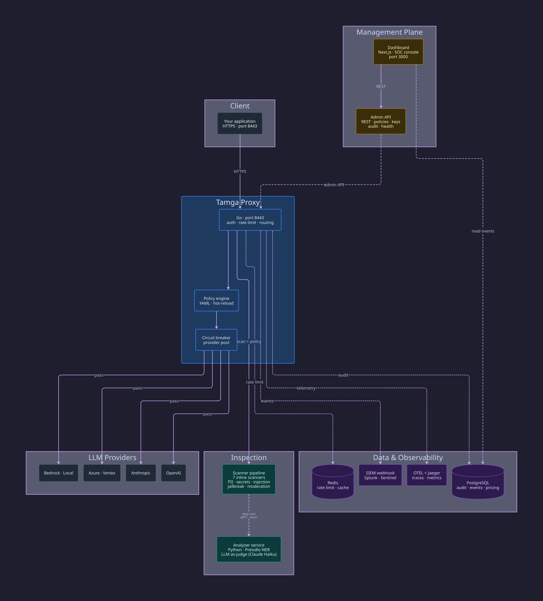
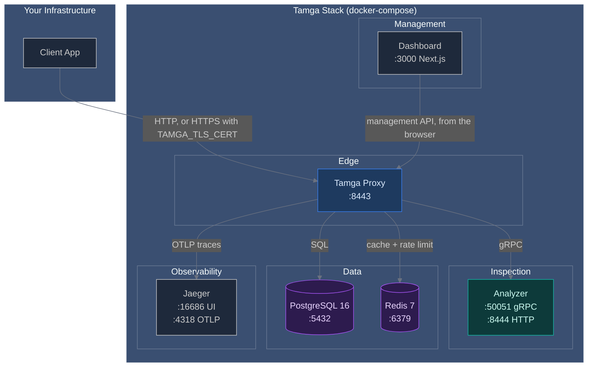
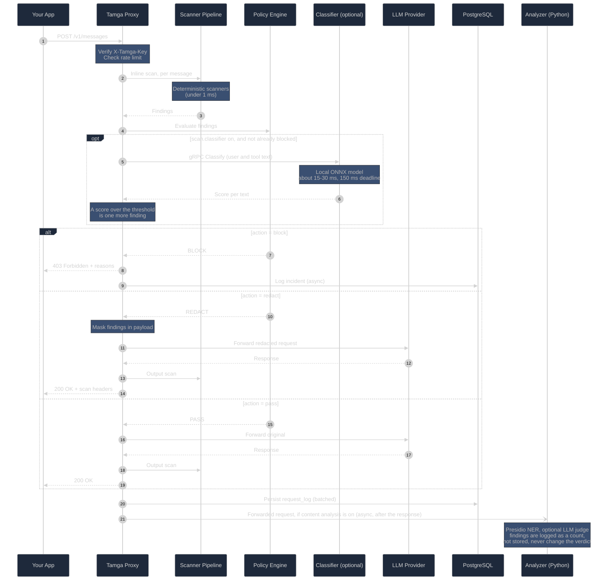
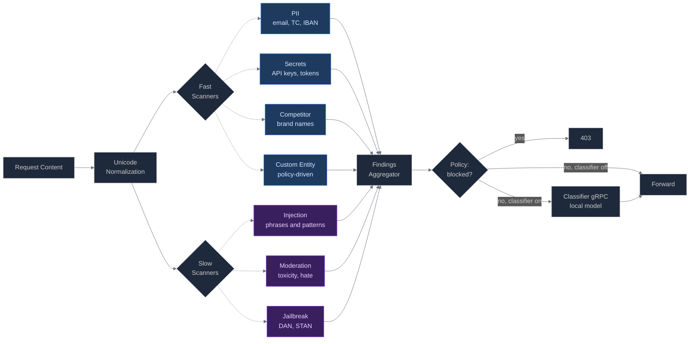
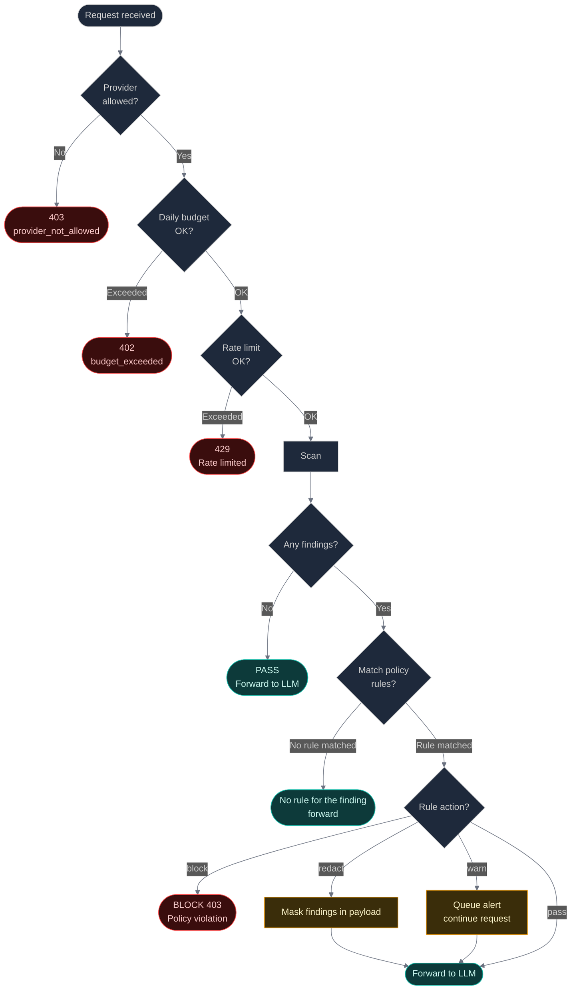
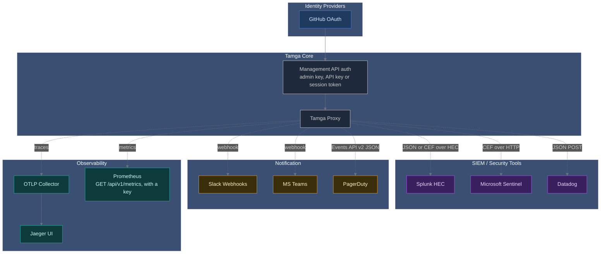

# Tamga Architecture

All architecture diagrams in one place. D2 sources and rendered SVG/PNG
versions live alongside this file.

## System overview

View the [D2 source](tamga.d2).

| Component | Language | Role | Port |
|---|---|---|---|
| Proxy | Go | Inline scanners, policy engine, reverse proxy, rate limiter, management API. One listener for all of it | `8443` |
| Scanner service | Go | Optional. Runs the stateless scanners over gRPC when `TAMGA_SCANNER_SERVICE_ADDR` is set | `50052` |
| Classifier | Python | Optional. Local prompt-injection model, asked inline when the rules did not block | `50052` |
| Analyzer | Python | The PDF compliance reports. Optionally (`TAMGA_ANALYZER_SEND_CONTENT`) a second look at forwarded requests after the decision: Presidio NER, and an LLM judge when `TAMGA_LLM_JUDGE` turns it on. Its findings are logged as a count; they change no verdict and are not stored | `50051` gRPC, `8444` HTTP |
| Dashboard | Next.js | The console. It runs in the browser and calls the proxy's management API directly | `3000` |
| PostgreSQL | — | Optional persistent telemetry and audit storage | `5432` |
| Redis | — | Rate limiting, caching, distributed counters | `6379` |
| NATS | — | Optional JetStream event stream, used when `TAMGA_NATS_URL` is set | `4222` |
| Jaeger | — | OpenTelemetry tracing (optional) | `16686` UI, `4318` OTLP |

## Deployment topology

`deploy/docker-compose.yml` puts every service on one internal bridge network
(`deploy_internal`). The proxy (`:8443`) and the dashboard (`:3000`) are
published to the host for use; the file also publishes the Jaeger UI
(`:16686`) and the NATS monitoring page (`:8222`) for local development.
PostgreSQL, Redis, the analyzer and the scanner service are reachable only
inside the network. The diagram leaves out NATS, the scanner service and the
optional classifier.

View the [full-size deployment diagram](deployment.svg) or [D2 source](deployment.d2).

## Request lifecycle

What happens when your app sends an LLM request through Tamga:

Scan overhead is a small fraction of total request time — provider latency
is usually 500-3000ms. See [benchmarks](../benchmarks/README.md) for
measured scan-stage numbers.

View the [D2 source](request-lifecycle.d2) or [full-size SVG](request-lifecycle.svg).

## Scanner pipeline

Seven inline scanners run on every request, and `operator_state` as an eighth
when it is configured. In the default `adaptive` mode the fast scanners run in
sequence and the slow ones in parallel. The diagram gives no timings; see
[benchmarks](../benchmarks/README.md) for measured numbers.

## Policy decisions

How Tamga determines whether to block, redact, warn, or pass a request.
Three checks come before any scanning and do not depend on findings: the
provider allowlist, the daily budget and the rate limit. The policy rules are
applied to the findings after that.

Order of the checks, as `handleProxy` in `proxy/internal/proxy/handler.go`
makes them:

1. The caller's key, when one is sent or `TAMGA_REQUIRE_KEY=true`: 401 if it is refused
2. Provider not allowed by the policy: 403 `provider_not_allowed`
3. Daily token or cost budget of the organisation exceeded: 402 `budget_exceeded`
4. Rate limit exceeded: 429, when `rate_limit.action_on_exceed` is to block
5. Scan, then the policy rules on the findings: block (403), redact (mask and
   forward), warn (forward), pass. Block, strip and warn each queue an alert

## Integrations

Twelve kinds of alert destination are defined in
`proxy/internal/webhooks/store.go`: Slack, Teams, Splunk (two kinds, JSON
and CEF), Sentinel, QRadar, Datadog, Jira, PagerDuty, Opsgenie, ServiceNow
and a generic webhook. Tamga can post alerts to a destination of one of
these kinds. The diagram shows six of them, each with the format it is
sent, next to sign-in and observability:

## Database schema

PostgreSQL is optional. The schema is the 19 numbered migrations in
[`deploy/migrations/`](../../deploy/migrations/); read them for the columns.
The tables they create:

| Table | Migration | Holds |
|---|---|---|
| `organizations` | 001 | Organisations; request rows refer to one |
| `request_logs` | 001, 003, 006, 017 | One row per request: metadata, action and masked findings. Partitioned by month on `created_at`, with a default partition |
| `audit_log` | 004 | The hash-chained log of administrative actions |
| `policy_revisions`, `policy_proposals` | 004 | Policy history and two-person proposals |
| `retention_run_log` | 005 | One row per run of the retention job |
| `analyzer_findings` | 007 | Written only by a direct call of the analyzer's `POST /api/v1/analyze` with `DATABASE_URL` set. Nothing the proxy sends the analyzer is stored here |
| `model_pricing` | 008, 009 | Price per model, used for cost |
| `incident_lifecycle` | 012, 014 | Triage state of incidents |
| `saved_hunts` | 013 | Saved event queries |
| `virtual_keys` | 015 | Tamga's own API keys, as a SHA-256 hash and a prefix |
| `stored_documents` | 016 | Custom patterns, team roles, SSO settings and webhooks, one JSON document each |

Migration 011 added row-level security to `request_logs` and `daily_stats`
and 018 removed it; it never had an effect. Migration 019 dropped five tables
that nothing read or wrote: `api_keys`, `policies`, `alerts` and `daily_stats`
from 001 and `event_outbox` from 010. See
[Upgrading the database](../operations.md#upgrading-the-database).

Retention: with `TAMGA_RETENTION_ENABLED=true` a daily job creates the monthly
partitions of `request_logs` and drops old data. Request logs are kept 30
days by default and the audit log 365
(`TAMGA_RETENTION_*_DAYS`).
